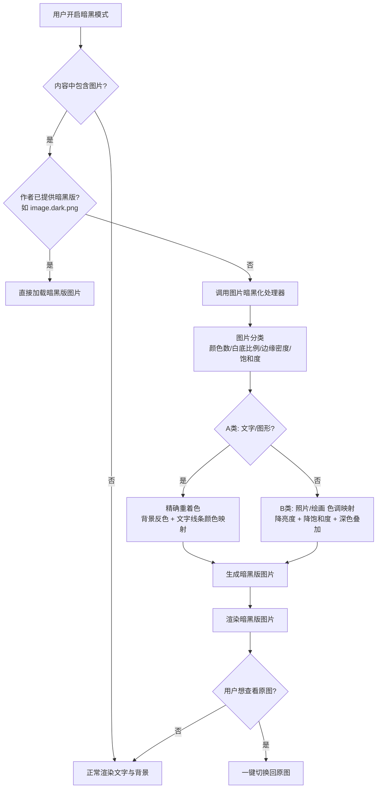
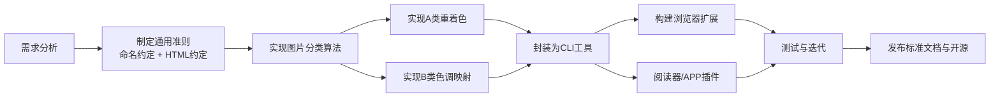

# 图片暗黑模式切换 —— 需求分析与方案

## 1. 背景

暗黑模式（Dark Mode）已成为操作系统、浏览器、阅读器与各类 APP 的标配。用户在夜间阅读电子书、浏览网页时，界面文字与背景可以正确切换为深色，但**内容中嵌入的图片往往保持不变**——尤其是白底插图，在暗黑模式下会异常刺眼，破坏整体体验。

典型场景：
- **Calibre 阅读 EPUB 电子书**（如《Hello 算法》）：文字与背景已正确切换为暗黑模式，但白底插图依旧刺眼。
- **Chrome 等浏览器**：网页平台自身适配了暗黑模式，但 `` 图片内容无法自动适配。
- **各类 APP / 资讯平台**：正文已切换暗黑模式，配图仍是白底/高亮原图。

### 现状：为什么现有方案不够好

| 现有做法 | 问题 |
|----------|------|
| CSS `filter: invert(1)` | 把整张图变成"负片"，照片的肤色、天空、色彩全部变得诡异 |
| 浏览器"强制深色"（Force Dark） | 对图片要么跳过、要么粗暴反色，效果不可控 |
| 作者手动准备暗黑版 | 没有统一标准，作者无法一次适配所有平台 |

**根本原因**：业界缺少一套"图片暗黑版"的通用准则与自动化工具。

## 2. 目标

1. 制定一套**通用准则**，让"图片的暗黑模式切换"在网页、电子书、APP 中可统一遵循，做到"在哪里都遵守同一套规则"。
2. 提供一套**图片处理工具**：当内容作者没有提供暗黑版图片时，自动为原图生成暗黑版。
3. 未来将工具嵌入 **Chrome 扩展、APP SDK、阅读器插件**，实现用户一键切换。
4. 用户在牺牲部分画面信息换取暗黑体验的同时，可以随时**一键查看原图**。

## 3. 图片分类

| 类别 | 典型例子 | 特征 | 暗黑化策略 |
|------|----------|------|-----------|
| **A 类：文字/图形类** | Visio/XMind 流程图、示意图、图表、截图、白底扫描页 | 本质是"可阅读的内容"：文字、线条、色块；背景通常为纯白/浅色 | **精确重着色**：背景反色、文字/线条颜色重映射，可获得接近"完美"的暗黑版 |
| **B 类：照片/绘画类** | 风景照、人物照、插画、油画 | 连续色调、细节丰富，没有"正确"的暗黑答案 | **色调映射**：降低亮度与饱和度、深色叠加，牺牲部分信息，保证不刺眼 |

### 3.1 A 类：文字/图形类 —— 可"完美"转换

流程图中的文字和背景，本质上与网页文字类似，因此可以精确映射：
- 白色/浅色背景 → 深色背景（如 `#FFFFFF` → `#1E1E1E`）
- 深色文字 → 浅色文字（如 `#000000` → `#E0E0E0`）
- 彩色元素 → 保持色相，调整明度/饱和度，使其在深色背景上仍可辨认
- **结果**：与原图信息等价的暗黑版，信息零丢失

### 3.2 B 类：照片/绘画类 —— 色调映射

照片没有"暗黑版"的标准答案，只能算法化地降低视觉刺激：
- 降低整体亮度（乘性变暗 + 深色叠加混合）
- 降低饱和度（鲜艳的颜色按比例降为柔和色调，例如深黄色 → 低饱和的浅黄色）
- 保持局部对比度，避免画面糊成一团
- **用户可一键切换查看原图**，作为信息丢失的补偿

## 4. 方案设计

整个方案分为三层：

### 4.1 标准层（准则）

- **命名约定**：暗黑版图片使用统一后缀，如 `image.png` ↔ `image.dark.png`，与原图同目录存放。
- **HTML 约定**：``，任何平台都能解析。
- **平台侧渲染规则**：配合 `prefers-color-scheme: dark` 媒体查询，暗黑模式下自动替换图片源。

```html
<!-- 内容作者提供暗黑版 -->

```

```js
// 平台侧：暗黑模式下替换图片源（浏览器扩展 / 网页脚本均可实现）
const img = document.querySelector('img[data-dark-src]');
if (window.matchMedia('(prefers-color-scheme: dark)').matches) {
  img.src = img.dataset.darkSrc;
}
```

**优先级**：
1. 作者提供了暗黑版 → 直接加载（完美体验）
2. 作者未提供 → 进入工具层，自动生成

### 4.2 工具层（核心）

一个图片处理程序，输入原图，输出暗黑版：

1. **图片分类**：判断图片属于 A 类还是 B 类
   - 启发式特征：颜色数量、近白/近黑像素比例、边缘密度、饱和度分布、文件大小/尺寸比、是否含透明通道
   - 作者可通过命名/元数据显式指定类型（如 `--type text|photo`）
2. **A 类处理**：背景反色 + 文字/线条颜色重映射
3. **B 类处理**：色调映射（亮度/饱和度调整）
4. **输出**：暗黑版图片（与原图同尺寸、同格式）

### 4.3 集成层（未来）

- **Chrome / Edge 浏览器扩展**：拦截图片，暗黑模式下自动替换或处理
- **阅读器插件**（如 Calibre 插件，解决 EPUB 插图刺眼问题）
- **APP SDK / 网页组件**：嵌入各类应用

## 5. 处理流程



## 6. 开发路线图



## 7. 技术选型（初步）

| 层 | 候选 | 说明 |
|----|------|------|
| 原型语言 | Python | Pillow / OpenCV / NumPy，适合快速验证图像算法 |
| 生产化 | TypeScript + sharp / WASM | 便于嵌入浏览器扩展 |
| 图片格式 | PNG / JPEG / WebP / GIF / AVIF | 需逐格式支持 |
| 分类模型 | 启发式优先，可选轻量 ML | 先规则、后模型 |

## 8. 里程碑

- **M1**：核心算法原型 —— Python CLI 工具，能对 A/B 两类图片生成暗黑版
- **M2**：浏览器扩展 —— 在暗黑模式下自动处理网页图片
- **M3**：标准文档发布 + 阅读器插件（Calibre）集成

## 9. 待讨论问题

- 实时处理的性能要求？（浏览器中需毫秒级 → 倾向预处理/缓存）
- B 类图片的变暗强度是否提供多档？（柔和 / 标准 / 强力）
- 是否引入 AI 重光照/重着色，获得更高质量的 B 类暗黑版？
- 是否支持动图（GIF/WebP 动画）逐帧处理？
- 命名约定 `image.dark.png` 是否与现有平台（Markdown 渲染器、CMS）兼容？

## 10. 下一步行动

1. 确认文件夹命名（建议 `image-dark-mode`）
2. 确认技术栈（是否采用 Python 做原型？）
3. 收集样例图片（白底流程图、照片各若干张），用于开发与验证算法
4. 开始实现 M1